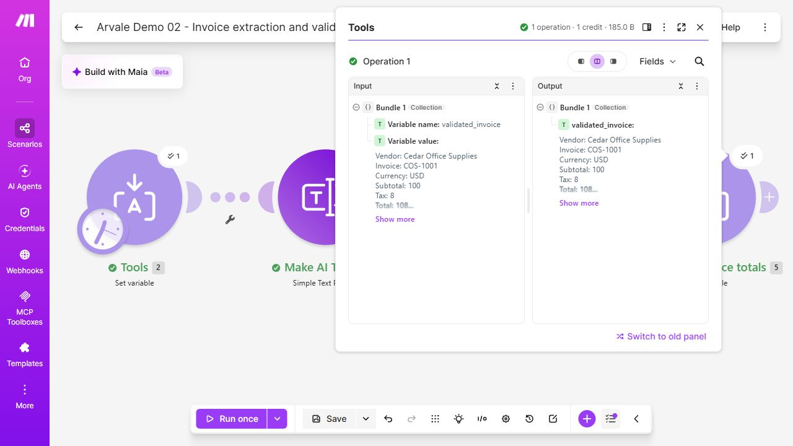

# Invoice extraction and validation

**Status:** Working Make.com workflow, run manually. Tested November 6, 2026 with fictional invoice text.

## Problem
Extracted invoice fields need validation before a person can rely on them.

## Workflow
Sample invoice text  >  Make AI Toolkit extraction  >  JSON parsing  >  separate arithmetic and missing-number checks  >  review result.

## Observed tests
| Case | Result |
| --- | --- |
| 100 subtotal + 8 tax = 108 total | review_ready |
| Same subtotal and tax, stated total 180 | total_mismatch |
| Invoice number omitted | missing_invoice_number |

## Design choices
AI handles text interpretation; separate rules check arithmetic and required information. Results support human review and do not authorize payment.

## Scope
Embedded sample input and execution-history output. PDF/OCR ingestion, persistent duplicate protection, accounting writes, and scheduled processing are future work.

## Example run

Sample invoice fields in an actual Make execution. The test cases above describe the validation results.
